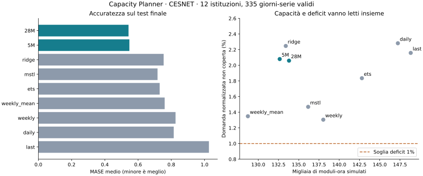

# Capacity Planner: risultato della validazione

Esperimento eseguito il 6 novembre 2026; documentazione completata il 7 novembre.

Questo è il primo esperimento. La [seconda ricerca](RESEARCH_V2.md) ne analizza
il fallimento, introduce una politica adattiva e la verifica su un periodo
nuovo del 2026. I numeri e il verdetto riportati qui restano quelli originali.

**Timestral migliora la previsione del traffico nel campione reale esaminato.
La politica di dimensionamento implementata non supera il criterio operativo.**
Sono due risultati distinti, entrambi conservati nella dashboard.

## Domanda e caso d'uso

Prevedere il traffico delle prossime 24 ore può aiutare chi deve programmare
capacità prima dei picchi. Il prototipo produce una curva prevista, intervalli,
un piano orario in moduli discreti e il confronto con il traffico osservato.
Il caso concretamente verificato usa traffico di rete, non CPU o code HTTP.
Il numero di moduli è una simulazione: non abbiamo misure di throughput di
server reali, latenza, accodamento, fatture o SLA.

## Dati e confronto congelato

- CESNET-TimeSeries24, byte misurati per istituzione e ora, convertiti in Mbit/s medi.
- 12 istituzioni estratte con seed 20261106 fra 276 ammissibili sul solo training:
  16, 22, 61, 67, 95, 108, 152, 166, 168, 209, 214, 242.
- Training iniziale: 9 ottobre 2023–18 maggio 2024, 5.352 ore. Contesto di ogni
  previsione limitato alle ultime 2.016 ore per tutti i metodi.
- Calibrazione: 19 maggio–1 giugno; selezione: 2–15 giugno;
  test finale: 16 giugno–13 luglio 2024, date UTC.
- 335 coppie istituzione/giorno complete nel test, su 336 possibili. Un giorno
  incompleto escluso per tutti i metodi; i target mancanti non diventano zero.
- 56 origini giornaliere per serie, nove metodi, 6.048 previsioni di 24 ore.
  Le 28 origini finali sono separate dalla scelta di modello e margine.

Il [protocollo](PROTOCOL.md) precede l'esecuzione. Hash dei sorgenti, checksum
dei dati e snapshot dei pesi sono nel [manifesto](../results/cesnet/protocol.json).
La selezione ha scelto Timestral 28M ed ETS. Nessun metodo soddisfaceva il
vincolo di deficit dell'1% già nel periodo di selezione: sono stati mantenuti
i candidati meno deficitari, come previsto, per una diagnosi sul test.
Questo impediva già di considerarli pronti per l'uso operativo.

## Precisione della previsione: vantaggio misurato

Sul test finale Timestral 28M ha MAE **1,7968 Mbit/s**, contro **2,2684** di ETS:
**20,79% di errore in meno**. L'analisi secondaria con bootstrap accoppiato
di istituzioni e blocchi settimanali dà un intervallo al 95% **[15,05%; 26,58%]**.
Il MAE medio per istituzione è inferiore a ETS in **12 istituzioni su 12**.

Il MASE medio è 0,5426 contro 0,7301 di ETS, riduzione del 25,68%
(intervallo [16,42%; 34,79%]). La migliore baseline classica per MASE sul test
è MSTL, 0,7171: rispetto a questa il 28M riduce il MASE di circa il 24,3%.
Quest'ultimo è un confronto descrittivo; non sostituisce la baseline scelta.
Anche il 5M è competitivo: MAE 1,8037, molto vicino a 1,7968 del 28M.
Non è dimostrato che la maggiore taglia dia un beneficio pratico rilevante.

La prova di accuratezza è empirica e circoscritta a questo campione. Gli
intervalli dell'analisi secondaria non correggono confronti multipli e non
trasformano 335 giorni-serie correlati in osservazioni indipendenti.

## Capacità pianificata: criterio operativo fallito

| Misura sul test | Timestral 28M | ETS scelto sulla selezione |
|---|---:|---:|
| Moduli-ora simulati | 133.800 | 142.798 |
| Domanda normalizzata non coperta | 2,060% | 1,835% |
| Obiettivo di deficit | ≤ 1% | ≤ 1% |

La riduzione di capacità è **6,30%**, intervallo al 95% **[3,46%; 9,86%]**.
La differenza di deficit AI meno ETS è **+0,224 punti percentuali**, intervallo
**[−0,031; +0,905]** punti. Il criterio richiedeva almeno il 10% di risparmio,
deficit entro l'1% e limite superiore della differenza non oltre +0,2 punti.
Non è soddisfatto. Non si può chiamare il 6,30% «risparmio a pari servizio».

Tutti i modelli hanno scelto il massimo margine candidato e tutti superano
l'1% di deficit sul test. È un limite della politica testata e della sua
calibrazione, non una dimostrazione che il forecasting sia inutile. Inoltre
alcune baseline consumano meno capacità dell'AI con minor deficit in questo
test: la media delle quattro settimane usa 128.721 moduli-ora e ha deficit
1,349%. Il confronto completo impedisce di nascondere questo risultato.

I p10/p90 grezzi del modello e gli intervalli calibrati non sono garanzie di
copertura. Gli intervalli calibrati nominalmente all'80% coprono il 71,84%
dei target per 28M e il 76,67% per ETS nel test; non vanno venduti come SLA.

## Cosa ha senso aggiornare in un sistema reale

**Ha senso sperimentare Timestral come componente di previsione** dove esistono
molte serie di traffico e una baseline da superare, inizialmente affiancandolo
al sistema corrente. Qui abbiamo misurato il vantaggio su dati reali e con
baseline stagionali, senza addestrare un modello diverso per ogni istituzione.

**Non è giustificato sostituire automaticamente il dimensionamento esistente
con questa politica.** Occorrono throughput reale per risorsa, una metrica
di servizio, costi, limiti di attivazione e un periodo nuovo. Margini adattivi,
calibrazione condizionale e fallback reattivi sono ipotesi per una successiva
versione, non risultati di questa ricerca. Non sono stati provati modificando
le regole sul test già osservato.

L'evidenza Coralogix che aveva motivato l'idea resta distinta: dati privati,
19 serie e un altro protocollo. Non è una replica locale. Qui la replica
pubblica dimostra un vantaggio previsionale e rende visibile il lavoro ancora
necessario per trasformarlo in una decisione operativa vantaggiosa.

## Verifiche, limiti e riproduzione

19 test Python passati: riempimento causale, baseline, vincoli del piano,
conservazione delle quantità, dati mancanti, selezione e bootstrap accoppiato.
Build TypeScript/Vite completato; tre test Chromium passati su desktop/mobile,
replay CESNET, esportazione CSV, tema e recupero degli errori. Inferenza reale
5M e 28M verificata anche attraverso l'API del servizio finale.
I 19 test sono passati anche dentro l'immagine finale. Ambiente del benchmark
e runtime sono registrati separatamente: ad esempio PyArrow è 26.0.0 nel
primo e 26.0.1 nell'app. I replay pubblicati conservano le previsioni originali;
non vengono ricalcolati dalla dashboard. Per replicare i numeri usare le
versioni dell'ambiente di validazione, oltre agli snapshot fissati.

Benchmark: 488 secondi con limite 2 GiB, 1 CPU, nessuna rete né swap aggiuntivo.
RAM host libera minima campionata: **7,06 GiB** durante preparazione, test e
benchmark. Gli otto servizi esistenti hanno mantenuto ID, avvio, contatore
riavvii e stato. Il quarto servizio usa un Compose separato su localhost:8504.

Limiti: dodici istituzioni, quattro settimane finali, stagionalità estiva,
dati pubblici potenzialmente presenti nel pretraining del modello. Questo
ultimo punto non è verificabile dagli artefatti disponibili. Nessun test
live di autoscaling e nessuna prova causale di risparmio in produzione.
Il dataset misura medie orarie: picchi entro l'ora e dinamiche di coda mancano.

La [matematica](MATHEMATICS.md) esplicita previsioni, calibrazione, capacità,
deficit e identità di conservazione; non promette un teorema di superiorità.
Per riprodurre l'esperimento seguire il [README](../README.md).

Artefatti principali:

- [Tabella di tutti i modelli](../results/cesnet/summary.csv),
  [errori per origine](../results/cesnet/scores.csv) e
  [scelte prima del test](../results/cesnet/selection_decisions.json).
- [Report e replay](../results/cesnet/report.json),
  [analisi secondaria](../results/cesnet/secondary_analysis.json),
  [array per ricontrollare il confronto](../results/cesnet/paired_simulations.npz).
- [Controllo delle risorse](../results/cesnet/run_54146442.json),
  [verifica del servizio](../results/cesnet/live_verification.json),
  [versioni runtime](../results/cesnet/runtime_versions.json) e
  [ambiente di validazione](../results/cesnet/validation_environment.json).

Fonti: [CESNET, pubblicazione degli autori](https://doi.org/10.1038/s41597-025-04603-x),
[HDF5 e licenza CC-BY-4.0](https://zenodo.org/records/23296272),
[benchmark Coralogix](https://benchmarks.coralogix.com/timestral-benchmarks).
