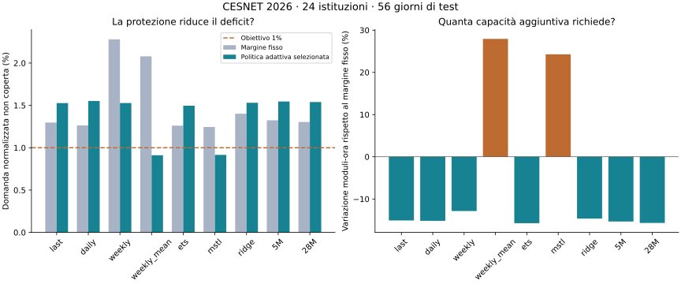
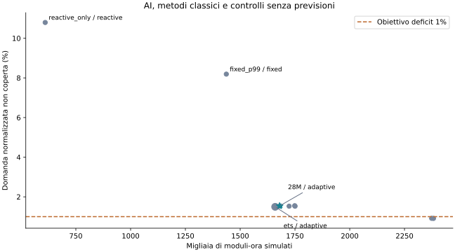

# Seconda ricerca: perché il piano falliva e cosa cambia con una protezione adattiva

Protocollo e inferenze del 7 novembre 2026; analisi completata l'8 novembre.
La [prima ricerca](RESEARCH.md) rimane invariata.
Questa fase riparte dal suo limite: una previsione migliore non aveva prodotto
un dimensionamento sufficientemente affidabile.

## Il problema individuato

Ho ricostruito i piani originali dalle previsioni salvate e verificato che
capacità e deficit coincidessero con il report V1. Per Timestral 28M:

- **85,79% del deficit** era concentrato nell'istituzione 242;
- le prime due istituzioni spiegavano il **92,45%** del deficit;
- due giorni spiegavano il **51,94%**;
- meno dell'1% delle ore spiegava l'intero deficit;
- rimuovere il ritardo della prima ora non riduceva il deficit.

Anche ETS aveva circa l'85% del deficit nella stessa istituzione. Non era
quindi un errore diffuso su tutto il campione o causato soltanto dall'AI.
Pochi picchi superavano il massimo errore visto nelle due settimane usate
per fissare il margine di sicurezza. Il 16 giugno 2024 alle 15 UTC, per
esempio, la domanda normalizzata dell'istituzione 242 superava 213 moduli,
mentre il piano 28M ne prevedeva 29. Non abbiamo escluso quel caso dal report.

Il deficit originale è normalizzato per il modulo di ciascuna istituzione:
non coincide con la quota di traffico grezzo totale persa dalla rete. La V2
riporta entrambe le misure e i risultati per istituzione per evitare che
un aggregato nasconda il comportamento delle serie più piccole o più difficili.

Il ricontrollo sui volumi grezzi della V1 dà deficit **0,2225% per 28M** e
**0,1960% per ETS**, contro 2,060% e 1,835% nella misura normalizzata. La quota
di deficit dell'istituzione 242 scende dall'85,79% al 9,50% contando i Mbit/s.
La media di quattro settimane passa a 0,3053% di deficit grezzo: la classifica
del piano cambia con il peso attribuito alle istituzioni di diversa scala.

È un risultato della diagnosi dell'obiettivo, non una correzione dei dati o
una riabilitazione del criterio fallito. Il criterio originale resta
normalizzato. Per un caso reale bisogna chiarire se conta soprattutto il
volume complessivo di rete o il trattamento delle singole istituzioni, e
aggiungere vincoli per istituzione quando richiesti dal servizio.
Fonte: [ricontrollo dei volumi grezzi](../results/capacity-v2/diagnosis_raw_traffic.json).

## La correzione da verificare

La nuova politica conserva il piano giornaliero, ma può usare due protezioni:

1. **Un margine aggiornato ogni giorno** con gli errori delle ultime due
   settimane concluse. Se il comportamento cambia, il margine può adattarsi.
2. **Una protezione reattiva** legata al traffico già osservato nelle ultime
   sei ore. Non anticipa un picco sconosciuto: interviene solo dopo che il
   sistema ha avuto il tempo di osservare il segnale e attivare la capacità.

L'attivazione richiede un'ora. Per dimensionare l'ora t la protezione può
usare al massimo il traffico dell'ora t−2, perché quello di t−1 diventa noto
solo all'inizio di t. La capacità aggiuntiva viene interamente conteggiata.
Questa scelta evita di simulare un sistema che reagisce istantaneamente
conoscendo già la domanda dell'ora che dovrebbe proteggere.

Gli stessi margini e le stesse protezioni sono disponibili per tutti i
metodi classici. Il confronto include anche un sistema esclusivamente
reattivo e capacità fissa prudenziale: serve a capire se l'AI aggiunge valore
oltre a una buona regola di controllo. Non basta confrontare AI migliorata
con una baseline lasciata senza protezioni.

## Un test nuovo, successivo a quello già osservato

Fonte: [CESNET-TimeSeries26](https://doi.org/10.5281/zenodo.21945629),
file orario delle istituzioni. Il download dal mirror ufficiale è stato
verificato con lo SHA-256 degli autori. La provenienza e il digest sono in
[source26.json](../data/source26.json). È la stessa rete del primo studio:
valutiamo la generalizzazione nel tempo, non verso un operatore indipendente.

Il [protocollo V2](PROTOCOL_V2.md) è stato fissato prima del confronto finale:

| Periodo UTC | Utilizzo |
|---|---|
| 15 settembre–7 dicembre 2025 | Ammissibilità delle istituzioni, scala dei moduli e storico iniziale |
| 8–21 dicembre 2025 | Prima calibrazione degli errori |
| 22 dicembre 2025–4 gennaio 2026 | Scelta di modello, politica e parametri |
| 5 gennaio–1 marzo 2026 | Test finale di otto settimane |

Ventiquattro istituzioni sono state estratte con seed fissato fra le 274
ammissibili sullo storico iniziale. Il test contiene 1.344 giornate-serie
complete. La copertura futura viene controllata, ma non usata per sostituire
serie che producono previsioni sfavorevoli.

Sono state mascherate 47 ore comuni dello storico: 22 ore che comprendono
tre interruzioni del monitoraggio e 25 ore del giorno locale del cambio
d'ora autunnale. È una scelta conservativa documentata; gli autori segnalano
che alcune aggregazioni orarie possono contenere somme parziali durante le
interruzioni. Le assenze non diventano traffico zero. Il periodo finale è
completo per tutte le istituzioni scelte.

Tutti i nove previsori hanno un contesto massimo di dodici settimane e un
orizzonte di 24 ore. I pesi 5M e 28M sono gli stessi della prima ricerca.
La scelta avviene sul periodo di selezione, compresi Natale e Capodanno:
questa differenza rispetto alle settimane successive è un limite da tenere
presente nell'interpretazione.

## Come decidiamo se funziona meglio

Il criterio primario resta quello della V1: almeno il 10% di capacità in meno
per l'AI, entrambi i piani entro l'1% di deficit su selezione e test, intervallo
del risparmio al 95% interamente positivo e limite superiore del peggioramento
del deficit entro +0,2 punti percentuali. Gli intervalli ricampionano insieme
istituzioni e blocchi settimanali, mantenendo accoppiati i metodi.

Separatamente vengono mostrati:

- quanto cambia ciascun modello passando dalla politica originale all'adattiva;
- quanta capacità aggiuntiva si paga per ridurre il deficit;
- quanto contribuisce la protezione reattiva rispetto al solo aggiornamento;
- quante istituzioni superano l'1% e il 5% di deficit;
- come cambia il verdetto usando traffico grezzo invece della normalizzazione;
- accuratezza previsionale, distinta dal comportamento del piano.

Le politiche originale e adattiva vengono entrambe eseguite sullo stesso
test 2026. Confrontare direttamente il deficit del 2024 con quello del 2026
non isolerebbe l'effetto della correzione, perché cambia anche il traffico.

## Risultato finale: previsione migliore, piano ancora insufficiente

Il confronto scelto prima del test è **Timestral 28M contro ETS**, entrambi
con margine adattivo e protezione reattiva 1,25. Sul periodo di selezione
rispettavano il limite: deficit 0,909% e 0,874%. Sul test nuovo:

| Misura | Timestral 28M | ETS |
|---|---:|---:|
| Errore medio assoluto della previsione, Mbit/s | 0,8034 | 1,2513 |
| Moduli-ora simulati | 1.679.669 | 1.659.699 |
| Domanda normalizzata non coperta | 1,540% | 1,496% |
| Domanda grezza non coperta, analisi secondaria | 0,673% | 0,651% |
| Istituzioni con deficit normalizzato oltre 1% | 9 su 24 | 10 su 24 |

**Il criterio primario non è soddisfatto.** L'AI richiede il **1,20% di
capacità in più**, con un deficit leggermente maggiore. L'intervallo al 95%
del risparmio AI è **[−5,44%; +2,46%]**: non dimostra un risparmio stabile,
né una superiorità generale di ETS. La differenza di deficit è +0,044 punti
percentuali, intervallo **[−0,032; +0,206]**. Entrambi superano l'1% richiesto.
Il risultato sul traffico grezzo è secondario e non sostituisce quel criterio.

L'analisi previsionale conferma invece un vantaggio: **MAE inferiore del
35,80% rispetto a ETS**, intervallo al 95% **[30,04%; 41,44%]**, con MAE minore
in tutte le 24 istituzioni. Rispetto alla migliore baseline classica per MAE
osservata nel test, la regressione con calendario (1,0202), il vantaggio è
circa **21,26%**. Quest'ultimo confronto è descrittivo: la baseline primaria
rimane ETS, scelta sul periodo precedente per il dimensionamento.

Non è una contraddizione: il MAE premia la precisione nelle ore comuni,
mentre il deficit dipende dagli errori verso il basso che superano la capacità
disponibile. Ridurre il primo non garantisce di coprire i picchi più difficili.

Fonti: [risultato primario e intervalli](../results/capacity-v2/report.json),
[accuratezza di tutti i modelli](../results/capacity-v2/forecast_summary.csv),
[incertezza dell'accuratezza](../results/capacity-v2/secondary_accuracy.json).

## La correzione ha aiutato? Separiamo i due meccanismi

La politica adattiva selezionata per il 28M usa il **15,67% di capacità in
meno** della politica originale applicata allo stesso test 2026, ma il deficit
sale da **1,305% a 1,540%**. Per ETS accade quasi lo stesso: −15,73% di capacità,
deficit da 1,261% a 1,496%. Non è un miglioramento a parità di servizio.

Una verifica secondaria mantiene fissi quantile e moltiplicatore del margine
del confronto primario, attivando separatamente aggiornamento e reazione:

| Configurazione 28M sul medesimo test | Moduli-ora | Deficit |
|---|---:|---:|
| Margine fisso, senza reazione | 1.991.840 | 1,305% |
| Margine fisso, con reazione | 2.016.190 | 1,169% |
| Margine aggiornato, senza reazione | 1.652.274 | 1,887% |
| Margine aggiornato, con reazione | 1.679.669 | 1,540% |

**La reazione aiuta, ma interviene dopo l'osservazione del traffico e costa
capacità. L'aggiornamento del margine rende il piano troppo piccolo per
l'obiettivo fissato.** Anche ETS mostra lo stesso meccanismo: con margine
fisso la reazione riduce il deficit da 1,261% a 1,123%; il margine aggiornato
senza reazione lo porta a 1,826%. Nemmeno margine fisso più reazione raggiunge
l'1% per questi due modelli. Non abbiamo cambiato la configurazione primaria
dopo questa diagnosi. Questa verifica isola i componenti del simulatore;
non è un esperimento causale su una rete in produzione.

La selezione minimizzava la capacità fra i piani entro soglia nel periodo
precedente. Quel vincolo non ha retto nelle otto settimane successive.
La selezione comprendeva le festività natalizie, mentre il test iniziava a
gennaio: è una possibile fragilità della calibrazione temporale, non una
causa dimostrata dell'intero deficit.

Fonti: [effetti delle politiche](../results/capacity-v2/policy_changes.csv),
[componenti isolati](../results/capacity-v2/factorial_ablation.csv),
[domanda nei due periodi](../results/capacity-v2/selection_test_load.csv).



## Alternative classiche e casi difficili

Le politiche adattive selezionate per MSTL e media di quattro settimane
ottengono rispettivamente **0,916% e 0,911%** di deficit aggregato nel test,
con **2.374.040 e 2.382.254 moduli-ora**. Rispetto alle rispettive politiche
originali pagano circa **24,28% e 27,93%** di capacità aggiuntiva. Sono confronti
secondari utili per vedere quanto costa la protezione; non vengono promossi
a vincitori primari dopo aver visto il risultato. Entrambi conservano una
istituzione oltre il 5% di deficit: il buon aggregato non garantisce ogni serie.

Le configurazioni selezionate dei controlli senza previsione fanno peggio
sulla copertura: **10,80%** di deficit per la sola reazione e **8,19%** per la
capacità fissa basata sul percentile 99 dello storico. Sono regole specifiche
con una griglia limitata, non tutte le possibili soluzioni senza AI.

Per il piano primario AI, l'istituzione 76 ha **11,43%** di deficit (11,55%
con ETS) e produce il 22,85% del deficit normalizzato complessivo. Il problema
è meno concentrato che nella V1: nove istituzioni superano l'1%. Non possiamo
risolvere la conclusione eliminando una sola serie sfavorevole.

Per 28M la domanda supera la capacità in **126 delle 32.256 ore-serie**
(0,391%); per ETS in 122 (0,378%). Tutto il deficit è quindi concentrato
in meno dell'1% delle ore, anche sul campione nuovo. Il margine previsionale,
prima della reazione e dell'arrotondamento in moduli, copre il 99,346% dei
target per 28M e il 99,383% per ETS. Un'alta percentuale di ore coperte può
convivere con un deficit volumetrico oltre soglia, se le poche ore scoperte
hanno picchi grandi. Non è una garanzia di copertura futura.

Fonti: [tutte le politiche selezionate](../results/capacity-v2/RESULTS_GENERATED.md),
[risultati per istituzione](../results/capacity-v2/institution_results.csv),
[ore critiche e copertura dei margini](../results/capacity-v2/primary_hour_diagnostics.json).



## Quanto costa eseguire il modello

Misura separata su una CPU, limite 2 GiB, stesso storico di 2.016 ore e
orizzonte di 24 ore. Ogni metodo parte in un processo nuovo; dopo il primo
avvio si ripete dieci volte la stessa previsione. Il tempo indicato è la
mediana a modello già caricato; la RAM è il picco RSS del processo, comprese
librerie e interprete. Non è il consumo dell'intero computer.

| Metodo | Tempo mediano per previsione | Picco RAM del processo |
|---|---:|---:|
| Regressione con calendario | 4,7 ms | 128 MiB |
| ETS | 209,1 ms | 234 MiB |
| Timestral 5M | 29,0 ms | 372 MiB |
| Timestral 28M | 113,8 ms | 544 MiB |

Il primo avvio del 28M richiede circa 2,46 secondi, inclusi caricamento e
importazioni. In questa misura il 28M è più rapido di ETS a caldo, ma richiede
più RAM; la regressione è molto più leggera. Il 5M offre un compromesso utile:
MAE 0,8297 rispetto a 0,8034 del 28M, con meno memoria e meno tempo. Non abbiamo
dimostrato che la taglia maggiore giustifichi il suo costo operativo.

Sono misure su questo ambiente e questo storico, non stime di fatture,
energia o prestazioni garantite su ogni serie.
Fonte: [misure complete e ambiente](../results/capacity-v2/runtime_benchmark.json).

## Decisione in parole semplici

**Userei Timestral come candidato per prevedere il traffico e confrontare
scenari. Non sostituirei il dimensionamento esistente con questa politica.**
La previsione è più precisa su un nuovo periodo reale, ma il piano AI non
rispetta il limite di domanda scoperta e non risparmia capacità rispetto a ETS.

Il valore del progetto portfolio è una verifica completa: diagnosi del primo
fallimento, correzione implementata, confronto equo su dati nuovi e una
decisione motivata anche quando l'ipotesi operativa non viene confermata.
Lo strumento permette di misurare questi compromessi prima di impegnare
risorse reali. Il beneficio economico resta una domanda aperta, non un
risultato da attribuire alla dashboard.

## Verifiche e risorse utilizzate

Completate **18.144 previsioni giornaliere**, inclusi calibrazione e selezione,
e **241 combinazioni** di previsore e politica. Non sono osservazioni
indipendenti: il test conta 24 istituzioni per 56 giorni. Passati **28 test
Python**, inclusi nove controlli nuovi su causalità, ritardo, dati mancanti,
continuità della capacità e confronto accoppiato. I controlli sugli artefatti
confermano somme per istituzione, simulazioni accoppiate e selezione primaria
invariata. Gli hash del protocollo e del codice congelato coincidono con
quelli registrati prima delle inferenze.

Le inferenze hanno richiesto circa 25,4 minuti. Limiti: 2 GiB, una CPU,
nessuna rete e nessuno swap aggiuntivo. La RAM host disponibile minima
campionata nei job V2 è stata **8,39 GiB**. Gli otto servizi già attivi sono
rimasti invariati; dashboard e modelli del quarto progetto restano spenti
a fine ricerca. I test browser della V1 non sono stati ripetuti: questa fase
non modifica i frontend.

Fonti: [controlli numerici](../results/capacity-v2/checks.json),
[registro delle verifiche software](../results/capacity-v2/software_validation.json),
[durata inferenze](../results/capacity-v2/forecast_run.json),
[risorse durante il benchmark](../results/capacity-v2/run_bb8edae9.json),
[ambiente](../results/capacity-v2/validation_environment.json).

## Limiti e significato pratico

Il simulatore misura capacità media oraria e domanda oltre quella capacità.
Non misura latenza, pacchetti persi, backlog o fatture. Un modulo ha una scala
normalizzata dallo storico, non il throughput misurato di uno SKU cloud.
Il traffico osservato viene usato come proxy della domanda: non ricostruisce
eventuale domanda già limitata o non servita dalla rete originale.
Non si simula un tetto fisico alla capacità o un limite di velocità di crescita:
anche un risultato positivo richiederebbe una verifica con quei vincoli.

Un picco isolato e imprevedibile può arrivare prima che la protezione reattiva
sia disponibile. Nessun modello o margine qui testato garantisce uno SLA.
Le istituzioni appartengono alla stessa rete, e il corpus di pretraining
di Timestral non è certificato come disgiunto da tutti i dati pubblici.

Questa ricerca produce una decisione verificabile sull'ipotesi testata.
Un esito sfavorevole viene conservato: non si ritoccano parametri sul test
finché il modello AI risulta vincitore.

## Riprodurre e controllare

Dalla radice del repository, con immagine e cache modello descritte nel
[README](../README.md):

```powershell
python capacityplanner/scripts/fetch_data.py --ts26
python capacityplanner/scripts/run_isolated.py --study capacity-v2 v2-diagnose
python capacityplanner/scripts/run_isolated.py --study capacity-v2 v2-inspect v2-prepare test v2-forecast v2-evaluate v2-report
python capacityplanner/scripts/run_isolated.py --study capacity-v2 v2-runtime environment
```

La dashboard resta spenta. I job di calcolo sono temporanei, senza rete,
limitati a 2 GiB e una CPU; la riserva RAM host è controllata durante il lavoro.
Lo stato dei servizi già attivi viene confrontato prima e dopo ogni esecuzione.
La dashboard esistente conserva i replay V1; la politica V2 e i controlli
reattivi sono implementati nel modulo di ricerca `policy_v2.py` e nei suoi
runner, senza cambiare i frontend dimostrativi.

Artefatti: [diagnosi V1](../results/capacity-v2/diagnosis.json),
[serie e controlli dei dati](../results/capacity-v2/data_selection.json),
[protocollo effettivo](../results/capacity-v2/protocol.json).
