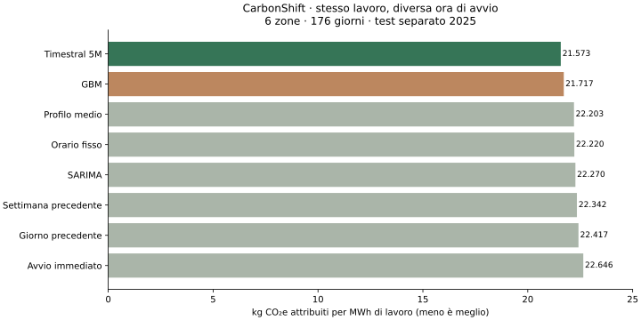
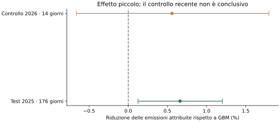

# CarbonShift: quando eseguire un lavoro differibile

Ricerca del 9 novembre 2026. Quinto progetto Aheadlab, separato dai precedenti.

**Nel test storico separato, Timestral 5M sceglie orari con emissioni attribuite
inferiori dello 0,66% rispetto alla migliore baseline selezionata, GBM, a
parità di lavoro ed energia. Il beneficio è piccolo. Il controllo recente
di 14 giorni non lo conferma con sufficiente precisione.**

## A cosa serve, in parole semplici

Devi eseguire un'elaborazione di quattro ore, ma puoi completarla entro
quattro giorni. Il lavoro consumerà la stessa energia in ogni caso. Lo
strumento prevede in quali ore il mix elettrico avrà minore intensità
carbonica e propone quando iniziare. La verifica confronta l'indicatore
effettivo nelle ore scelte, non soltanto quanto era precisa la previsione.

Esempi compatibili: un'elaborazione batch, un rendering non urgente o una
ricarica che può attendere. Non è adatto a richieste interattive o attività
con avvio immediato obbligatorio. Il simulatore considera un lavoro isolato,
senza conflitti con altri lavori o variazioni del suo consumo.

La dashboard contiene 54 replay, confronti modificabili, grafico delle
previsioni e delle finestre, esportazione CSV e risultati completi. Include
anche inferenza locale 5M su un CSV fornito dall'utente; quel risultato è
una proposta da verificare quando arrivano le osservazioni future.
Non invia comandi a infrastrutture, non accende server o ricariche.

## Come siamo arrivati a questo caso

La precedente ricerca Capacity Planner aveva un buon MAE ma non un vantaggio
nel dimensionamento. Cercare un uso diverso non significa cambiare quei
risultati. Abbiamo prima verificato la scelta di finestre di manutenzione
sui vecchi dati CESNET: una media oraria classica superava l'AI. Il caso è
stato scartato prima di costruire una dashboard; il risultato resta in
[window_screening.csv](../../validation/case_search/window_screening.csv).

Abbiamo poi trovato lo studio pubblico
[Khepri-TSFM di Eirik Botten Nicolaysen / EcoDeco AS](https://arxiv.org/abs/2611.02895).
Il lavoro degli autori riguarda l'accuratezza dell'intensità carbonica; la
nostra estensione misura una decisione di programmazione. Non attribuiamo
agli autori il nostro risultato operativo. Le loro serie, previsioni e
baseline sono pubbliche e riutilizzabili con attribuzione.

L'esplorazione gennaio–giugno 2025 ha confrontato durate 2/4/8 ore e scadenze
24/48/96 ore, mediana AI e approssimazione della media dai quantili. Tutti i
risultati sono in [carbon_screening.csv](../../validation/case_search/carbon_screening.csv).
Abbiamo quindi fissato il caso 4 ore entro 96, la mediana 5M e il criterio
prima di calcolare il risultato operativo sui periodi successivi. È una
selezione dichiarata sullo sviluppo, non una conferma indipendente su quei
primi sei mesi. Il [protocollo](PROTOCOL.md) è locale, non preregistrato presso
un ente esterno. I risultati previsionali del paper erano già pubblici.

## Provenienza e qualità dei dati

Fonte: [Khepri-TSFM v1.0.1](https://doi.org/10.5281/zenodo.23912503), commit
`f968f271487a110956ff1e29b9a88001d523aeb4`, dati derivati da ENTSO-E A75.
Serie e previsioni distribuite con licenza CC BY 4.0. I dati non sono misure
di CO2 del singolo lavoro: sono intensità calcolate dal mix di produzione.

I download sono verificati contro gli identificatori dei blob Git e i
digest SHA-256 registrati. Il benchmark controlla duplicati, valori finiti,
non negatività del target, griglia oraria, 96 orizzonti per origine,
corrispondenza fra target e timestamp e identità delle osservazioni fra
file dei diversi metodi e serie di riferimento.

La fonte documenta ore imputate in NO2, NO3 e NO5. Il confronto primario usa
le sei zone prive di target riempiti nel periodo documentato: **NO1, NO4,
SE1, SE2, SE3, SE4**. La scelta è motivata dalla qualità, non da quale modello
vince. Conserviamo anche il risultato su tutte le nove zone, separatamente.
Gli hash garantiscono l'integrità del download, non l'esattezza dei dati
originali né dei fattori di emissione usati dagli autori.

Fonti: [manifesto dei download](../data/source.json),
[descrizione originale dei dati e limiti](https://arxiv.org/html/2611.02895v1#S3.SS8).

## Confronto equo e periodi separati

Tutti completano lo stesso lavoro con lo stesso consumo e la stessa scadenza.
La scelta cerca il minimo fra le finestre consecutive ammissibili; parità
risolte scegliendo l'avvio più vicino. Le osservazioni future servono solo
a valutare il risultato. [Formule e invarianti](MATHEMATICS.md).

| Periodo di origine | Funzione |
|---|---|
| 1 gennaio–30 giugno 2025 | Sviluppo e scelta della baseline |
| 1–4 luglio 2025 | Separazione: nessun punteggio finale |
| 5 luglio–27 dicembre 2025 | Test separato: 176 giorni × 6 zone, 1.056 casi |
| 16–29 ottobre 2026 | Controllo dopo il rilascio: 14 giorni × 6 zone, 84 casi |

Confronti: Timestral 5M, SARIMA, GBM, settimana precedente, giorno precedente,
profilo orario medio su 28 giorni, orario fisso scelto sul 2024 e avvio
immediato. **GBM è stato selezionato sui dati di sviluppo** e scritto nel
file delle scelte prima di calcolare le prestazioni finali. Il migliore
osservato sul test non sostituisce questa scelta.

Timestral usa 8.192 ore e prevede 96 ore senza addestramento sul caso.
SARIMA e GBM mantengono addestramenti e configurazioni dello studio originale:
il GBM retrospettivo è addestrato su origini precedenti al 2024, non aggiornato
giornalmente. È una baseline pubblicata e riproducibile, ma non equivale a
un GBM continuamente riaddestrato e ottimizzato per la nostra decisione.
Non affermiamo superiorità contro tutti i modelli classici o moderni.

## Risultato sul test separato 2025

| Metodo | kg CO₂e attribuiti per MWh di lavoro |
|---|---:|
| Timestral 5M | 21,573 |
| GBM, riferimento selezionato | 21,717 |
| Profilo orario medio | 22,203 |
| Orario fisso dal 2024 | 22,220 |
| SARIMA | 22,270 |
| Settimana precedente | 22,342 |
| Giorno precedente | 22,417 |
| Avvio immediato | 22,646 |

Rispetto a GBM: **−0,662%**, intervallo al 95% **[0,124%; 1,202%]**.
Con blocchi statistici di 14 giorni invece di sette, l'intervallo rimane
positivo: **[0,106%; 1,243%]**. Il criterio fissato (almeno 0,5%, intervallo
positivo, lavoro ed energia invariati) è soddisfatto nel campione storico.
Timestral fa meglio in 101 dei 176 giorni aggregati e in cinque delle sei
zone. Non vince tutti i casi: i replay mostrano anche risultati sfavorevoli.

**Dimensione concreta:** per 1 MWh di lavoro, la differenza rispetto a GBM
è circa **144 grammi di CO₂e attribuita**; per 100 kWh, circa **14 grammi**.
Rispetto all'avvio immediato la riduzione è circa **4,74%**, ma quest'ultimo
è un riferimento più semplice. Non va usato al posto dello 0,66% per
nascondere che un buon metodo classico ottiene già gran parte del beneficio.

L'attesa media è 43,13 ore con AI e 42,94 con GBM. Si può aspettare perché
il caso è differibile: non si assume che ogni attività abbia questa libertà.

## Controllo successivo al rilascio del modello

Sulle 14 origini di ottobre 2026: **−0,559%** rispetto a GBM, intervallo al
95% **[−0,661%; +1,797%]**. Il segno puntuale è favorevole ma l'intervallo
comprende anche un peggioramento: **risultato non conclusivo**. Non possiamo
presentarlo come una conferma robusta su dati successivi al rilascio.

Il bootstrap a blocchi 14 su soli 14 giorni è degenere, perché ogni campione
contiene l'intera serie: quel campo nel JSON meccanico del benchmark non
misura incertezza e viene escluso dalla dashboard. La sensibilità a blocchi
14 resta valida sul periodo lungo. La diagnosi non modifica la coppia
primaria né il suo intervallo a blocchi sette.

## Riproduzione locale e costo di inferenza

Le previsioni complete del benchmark sono quelle pubblicate dagli autori.
Abbiamo ricalcolato localmente un campione sistematico di **24 previsioni**:
sei zone alle origini 5 luglio, 1 ottobre e 27 dicembre 2025 e 16 ottobre 2026.
Stessa libreria e stesso snapshot Timestral 5M della fonte.

Massima differenza assoluta dalla mediana pubblicata: **0,0000134 g/kWh**;
la finestra scelta coincide in **24 casi su 24**. Questo verifica quel
campione, non significa che tutte le inferenze pubblicate siano state rifatte.

Una CPU, limite 2 GiB: mediana **87 ms** per previsione, picco RSS del processo
circa **497 MiB**, inclusi Python e librerie. Tempi specifici dell'ambiente,
senza stima dell'energia elettrica consumata. La misura non è un ROI.
Fonte: [riproduzione locale](../results/local_reproduction.json).

## Che cosa possiamo affermare

Esiste qui un vantaggio misurato sulla **scelta dell'orario**, oltre al solo
errore previsionale. È piccolo e condizionato al simulatore, alle zone,
al periodo e alle baseline. Ha senso come componente sperimentale di un
sistema con molti carichi flessibili; non giustifica da solo una migrazione.

Non abbiamo misurato risparmio monetario, emissioni marginali evitate,
fatture, energia di inferenza, costi di attesa o manutenzione del software.
Non abbiamo eseguito un carico reale. Il 2025 può sovrapporsi ai dati di
pretraining; il controllo successivo al rilascio è breve. Le revisioni e
i ritardi di pubblicazione dei dati ENTSO-E non sono simulati. Il risultato
è una prova retrospettiva sul modello contabile, non una certificazione
ambientale o di convenienza economica in produzione.

## Artefatti e riproduzione

[Protocollo](PROTOCOL.md), [formule](MATHEMATICS.md),
[scelta prima del test](../results/selection.json),
[risultato primario](../results/report.json),
[tabella dei metodi](../results/summary.csv),
[risultati per zona](../results/zone_summary.csv),
[tutte le decisioni](../results/decisions.csv),
[controlli numerici](../results/audit.json).

Il [README](../README.md) contiene i comandi. I job sono isolati, con riserva
RAM verificata e confronto dello stato dei servizi preesistenti. I quattro
progetti precedenti rimangono invariati.
