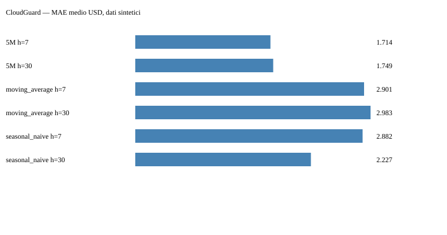

# CloudGuard

Documentazione: [guida operativa e API](docs/OPERATIONS.md) · [contratti](SPEC.md).

Previsioni dei costi cloud per servizio, stima di fine mese e allarmi leggibili. Demo autonoma **sintetica in USD**, senza chiamate AWS, invii Telegram o download pesi impliciti.

## Il problema
Un'istanza dimenticata o un loop possono far crescere la bolletta. CloudGuard confronta il costo con lo storico e mostra quanto potrebbe costare il resto del mese. È un portfolio sperimentale, non un sostituto di AWS Budgets/Cost Anomaly Detection; multi-account e produzione non sono implementati.

**Pipeline:** dati sintetici / AWS esplicito → calendario giornaliero per servizio → baseline oppure Timestral → stima mensile, allarmi, dashboard e benchmark rolling.

## Demo e risultati
La dashboard locale include storico, previsione a 30 giorni, selezione servizio/modello, cutoff mensile, allarmi e pagina risultati. Hosting pubblico e screenshot interattivo non ancora disponibili.



Risultati **realmente eseguiti**, dataset seed 7, 400 giorni fino al 31/12/2025, cinque servizi; 20 origini per servizio, passo 7. Media aritmetica delle metriche servizio/fold (non metrica di una serie aggregata):

| Metodo | Orizzonte | MAE USD | MASE (m=7) | Copertura 80% |
|---|---:|---:|---:|---|
| Timestral 5M | 7 | 1,714 | 0,700 | 82% |
| Timestral 5M | 30 | 1,749 | 0,716 | 84% |
| Media mobile 28 | 7 | 2,901 | 1,020 | non disponibile |
| Media mobile 28 | 30 | 2,983 | 1,048 | non disponibile |
| Seasonal naive 7 | 7 | 2,882 | 1,123 | non disponibile |
| Seasonal naive 7 | 30 | 2,227 | 1,076 | non disponibile |

Allarmi media28 + 3σ, scarto minimo 5 USD: **1.500 giorni valutati**, 22 giorni anomali, 21 trovati, 0 falsi allarmi; precisione 100%, recall giornaliero 95,45%. Eventi trovati **10/10 nel periodo valutato**, non 10/15: cinque eventi cadono fuori dalla finestra ultimi 300 giorni. Recall eventi 100%. Questi risultati sintetici non dimostrano efficacia su AWS reale. Il benchmark completo **Timestral 5M è stato eseguito** in `results/timestral-full/`: trova anch'esso 10/10 eventi e nessun falso allarme, ma soltanto **11/22 giorni anomali (recall 50%)**, peggio del 95,45% della regola classica. Migliorare la previsione non garantisce un miglior rilevatore di anomalie.

La dashboard consente di scegliere il report completo 5M e il report baseline. Artefatti baseline: `results/backtest.csv`, `anomalies.csv`, `anomaly_days.csv`, `events.csv`, `metadata.json`, `benchmark.svg`. Baseline senza quantili: copertura CSV vuota, non zero. Origini sovrapposte non sono campioni indipendenti. Il modello vede i picchi passati, realisticamente può adattarsi ad essi.

## Eseguire in locale
Da questa cartella, Python 3.11+:

```bash
python -m venv .venv
# Linux/macOS: source .venv/bin/activate
# Windows PowerShell: .venv\Scripts\Activate.ps1
pip install -e .
pytest -q
python scripts/run_backtest.py --quick --model baseline --output results/smoke
python scripts/run_backtest.py --model baseline
python -m cloudguard.daily
streamlit run app/streamlit_app.py
```

La baseline non richiede torch/Timestral. Per il modello vero (CPU):

```bash
pip install torch --index-url https://download.pytorch.org/whl/cpu
pip install -r requirements-model.txt
python scripts/run_backtest.py --quick --model 5M --output results/timestral-smoke
python scripts/run_backtest.py --model 5M --output results/timestral-full
```

Disponibili `5M`, `28M`, `123M`, `209M`. Il benchmark completo Timestral aggiunge le due baseline previsionali e la regola 3σ; può essere lento (1.500 previsioni a un passo più rolling). Il primo utilizzo scarica pesi Hugging Face, cache standard `~/.cache/huggingface`; nessun fallback silenzioso. La dashboard parte sempre in baseline; la selezione Timestral è esplicita.

Docker CPU, dalla cartella standalone:

```bash
docker build --build-arg INSTALL_MODEL=true -t cloudguard .
docker run --rm -p 127.0.0.1:8501:8501 cloudguard
```

## AWS e Telegram: attivazione deliberata

```bash
# Configurare credenziali AWS tramite la normale credential chain boto3
python -m cloudguard.daily --mode aws --model baseline
# Solo questo flag abilita invii; impostare TELEGRAM_TOKEN e TELEGRAM_CHAT_ID
python -m cloudguard.daily --mode aws --model 5M --send
```

IAM minimo `ce:GetCostAndUsage`, Cost Explorer attivo, client `us-east-1`. Il client è iniettabile per test; paginazione completa, costo `UnblendedCost`, valuta e `Estimated` conservati. La richiesta usa fine esclusiva. Costi API e disponibilità dello storico vanno verificati sul listino/account AWS; ridurre `giorni` nell'API Python se il periodo non è disponibile. Nessun account reale è stato testato. `.env` non viene caricato implicitamente: esportare le variabili nell'ambiente. Non inserire segreti nei file o negli output.

Telegram è dry-run senza `--send`, timeout 15s, errori sanitizzati senza URL/token. Il bot reale non è stato testato. `daily` produce JSON e invia solo anomalie, senza deduplicazione persistente: una riesecuzione con `--send` può ripetere il messaggio. Non c'è catch-up dei dati finalizzati: un giorno saltato perché provvisorio non viene automaticamente rianalizzato il giorno dopo. Queste limitazioni vanno risolte prima dell'uso come monitoraggio di produzione. Workflow CI e daily sono pronte per il repository **esportato**; GitHub ignora workflow annidate nel monorepo. Schedule demo senza segreti, AWS o Telegram.

## Limiti e convenzioni
- Ultimo giorno candidato per allarmi: al massimo oggi meno due giorni; qualunque `Estimated` nel prefisso sospende la valutazione per prudenza. Nessun giorno provvisorio diventa zero. La demo usa un orologio fisso coerente con i dati.
- Le valute non si mescolano: selezionare una valuta prima del pivot. Soglia minima in unità della valuta, non sempre euro.
- Giorni mancanti trattati come costo zero: verificare completezza prima dell'uso reale. Servizi con meno di 60 giorni positivi o totale <1 esclusi dal pivot. Tutti i cinque servizi sintetici sono inclusi nel benchmark; la selezione è congelata sul training prima della prima origine di valutazione. Anche daily determina l'idoneità prima del giorno valutato. Lo stato Estimated viene conservato anche per date AWS senza Groups.
- La stima mensile si riferisce all'ultimo dato, non alla data del computer. A fine mese non chiama il modello. Sommare p10/p90 giornalieri è **euristico**, non dà quantili del totale, non è necessariamente prudente e non garantisce copertura. Baseline: nessuna banda inventata.
- Crediti, rimborsi, Savings Plans e servizi nuovi possono invalidare le soglie; costi negativi conservati. Tarare per cliente, non interpretare anomalie come frodi.
- Event recall misura almeno un giorno rilevato nell'evento; day recall tutti i giorni anomali effettivamente valutati. Denominatore nullo = NaN.

## Stack e licenze
Python, NumPy, pandas, boto3, Plotly, Streamlit, requests; Timestral solo nel wrapper `forecaster.py`. Test di dominio isolati con forecasting mock; test con pesi reali separati e opt-in. Codice MIT. Timestral libreria Apache 2.0; pesi Mistral con MIT modificata, esclusione per aziende con fatturato consolidato **mensile** oltre 20 milioni USD nel mese precedente: leggere la licenza upstream prima dell'uso commerciale. Nessun peso ridistribuito. Dati demo generati localmente, mai costi di terzi.
