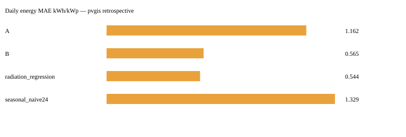

# SolarCast

Previsioni fotovoltaiche a 48 ore e fasce consigliate per l'autoconsumo, con confronto fra Timestral, persistenza e regressione sulla radiazione.

## Il problema e il funzionamento
Sapere quando produrre energia aiuta a spostare i consumi. La pipeline è: produzione oraria + meteo → calendario UTC → previsione → energia e fasce locali Europe/Rome. La dashboard parte da una **demo sintetica retrospettiva**, senza rete. La pagina PVGIS usa dati satellitari simulati e meteo storico, non misure di un impianto reale.

- **A:** Timestral sullo storico della produzione.
- **B:** Timestral con radiazione, nuvolosità e temperatura a futuro noto.
- **Baseline:** stesso profilo delle ultime 24 ore e regressione lineare sulla radiazione, stimata sugli ultimi 30 giorni del solo training.
- Le bande p10–p90 provengono dal modello vero. Le baseline non hanno intervalli inventati.
- Le fasce su p10 sono prudenti rispetto alla previsione marginale, non garanzie di disponibilità. Con baseline le fasce sono dichiarate **indicative sulla mediana**.

## Avvio locale
Dalla cartella `solarcast/`, Python 3.11+:

```bash
pip install -e .
pytest -q
streamlit run app/streamlit_app.py
python scripts/daily.py
python scripts/run_backtest.py --quick --output results/smoke-baseline
```

Per Timestral CPU:

```bash
pip install torch --index-url https://download.pytorch.org/whl/cpu
pip install -r requirements-model.txt
# Linux/macOS: RUN_MODEL_TESTS=1 pytest -q
# PowerShell: $env:RUN_MODEL_TESTS='1'; pytest -q
python scripts/run_backtest.py --data pvgis --model 5M --output results/pvgis-5M
python scripts/run_backtest.py --data pvgis --model 28M --quick --output results/pvgis-28M-smoke
```

Docker autonomo:

```bash
docker build --build-arg INSTALL_MODEL=true -t solarcast .
docker run --rm -p 127.0.0.1:8503:8501 solarcast
```

L'installazione senza modello consente demo e baseline. Il download pesi avviene alla selezione esplicita di Timestral, senza fallback. `OMP_NUM_THREADS=2` limita l'uso CPU nel container. I dati pubblici sono memorizzati in `data/raw/`, con chiavi comprendenti endpoint, località, periodo e geometria; non vengono inclusi nel repository.

## Backtest e risultati
La CLI completa usa due anni (default 2022–2023, Varese), origini giornaliere a mezzanotte dell'ultimo anno e orizzonte 48 ore. L'origine del 31 dicembre è esclusa perché richiederebbe dati dell'anno successivo. I due giorni di ogni origine vengono valutati separatamente: osservazioni sovrapposte **non sono campioni indipendenti**. Contesto massimo full 8.784 ore; `--max-context` permette di variarlo. Lo smoke usa quattro origini, una per stagione, e 720 ore di contesto: non è un benchmark annuale.

Artefatti: `daily.csv`, `summary.csv`, `metadata.json`, `summary.svg` nella cartella scelta. Metriche: MAE dell'energia giornaliera in kWh/kWp, MAE orario nelle ore con radiazione >0, copertura p10–p90 e raggruppamenti per stagione e cielo. Dati mancanti non sono zeri: totale giornaliero solo per giorni completi, errori orari sulle coppie finite.

**B e la regressione ricevono meteo osservato futuro: sono confronti oracle ottimistici, non risultati operativi.** La dashboard mostra i report disponibili insieme al relativo protocollo. Non si rivendica un miglioramento del modello senza leggere i CSV effettivamente generati.

### Misure effettivamente eseguite

Benchmark completo 5M su PVGIS Varese 2022–2023: **364 origini nel 2023**, 48 ore per origine, 728 coppie origine/giorno per metodo. Artefatti in [`results/pvgis-5M/`](results/pvgis-5M/).

| Metodo | MAE energia giornaliera (kWh/kWp) | MAE orario diurno | Copertura 10–90% |
|---|---:|---:|---:|
| Timestral A, solo storico | 1,1620 | 0,1068 | 90,37% |
| Timestral B, meteo oracle | 0,5647 | 0,0665 | 84,79% |
| Regressione, meteo oracle | **0,5440** | 0,0913 | non disponibile |
| Persiste ultime 24 ore | 1,3288 | 0,1209 | non disponibile |

**La regressione batte B sull'energia giornaliera**, mentre B ha minore errore orario diurno. Sono metriche diverse; non si nasconde il risultato sfavorevole. La copertura include anche ore notturne, quindi non misura da sola la qualità nelle ore produttive.



`results/pvgis-28M-smoke/` contiene invece quattro origini stagionali con 720 ore di contesto: solo smoke con modello reale, non confronto diretto di taglie rispetto al protocollo annuale. `results/smoke-baseline/` è sintetico. Suite finale: **55 test passati**, inclusi due test di inferenza reale; dashboard A e B provate anche nell'immagine Docker.

## Previsione operativa e notifiche
Non si collega lo storico PVGIS di anni fa al meteo di oggi fingendo una continuità inesistente. L'API Python `solarcast.forecast.forecast(history, future_weather, method='B', operational=True)` richiede produzione recente, normalizzata in kWh/kWp, un indice UTC orario e meteo immediatamente successivo. `history` contiene `kwh`, `shortwave_radiation`, `cloud_cover`, `temperature_2m`; il futuro contiene le tre covariate. `scarica_meteo_previsto` scarica il meteo attuale, con cache giornaliera. L'acquisizione da inverter e la raccolta di misure recenti restano a carico dell'utilizzatore.

`solarcast.notify.telegram` è dry-run di default; inviare richiede attivazione esplicita e variabili `TELEGRAM_TOKEN`, `TELEGRAM_CHAT_ID`. `scripts/daily.py` e la schedulazione inclusa sono soltanto demo retrospettive senza invio. Nessun bot reale o deployment pubblico è stato configurato. I workflow annidati funzionano dopo l'esportazione del repository.

## Limiti e licenze
- Pesi Timestral: MIT modificata Mistral, con restrizione per fatturato consolidato mensile superiore a 20 milioni USD nel mese precedente. [Licenza ufficiale](https://huggingface.co/mistralai/Timestral-5M/blob/main/LICENSE). Codice libreria Apache 2.0; codice di questo progetto MIT.
- **PVGIS © European Union**, [fonte JRC](https://re.jrc.ec.europa.eu/pvg_tools/en/). Produzione simulata, non misurata. `P` in watt è diviso per 1000 come approssimazione dell'energia oraria; i campioni satellitari e le medie orarie meteo possono avere convenzioni temporali diverse.
- Meteo da [Open-Meteo](https://open-meteo.com/), attribuzione CC BY 4.0. API gratuita destinata all'uso non commerciale; verificare condizioni e piano per un prodotto commerciale.
- Neve, ombre locali, sporco e guasti non sono modellati. La qualità operativa dipende dal meteo previsto.
- Produzione interna per 1 kWp; potenza scalata una sola volta. Fasce semiaperte con l'ultima ora inclusa, durata fisica corretta anche al cambio d'ora.
- Sommare quantili orari non produce un intervallo calibrato dell'energia totale.
