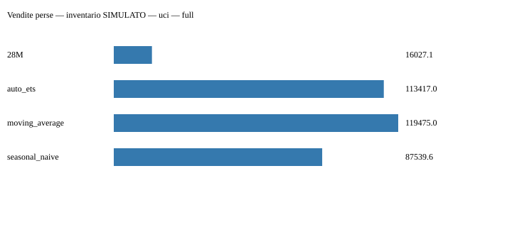

# StockSense

Documentazione: [guida operativa e API](docs/OPERATIONS.md) · [contratti](SPEC.md).

Previsioni giornaliere di vendita, proposte di riordino e confronto delle politiche di magazzino. Progetto Python autonomo: nessun import dagli altri progetti del portfolio.

**Demo sintetica offline per default. Giacenze sempre SIMULATE, non giacenze UCI.** Nessun ordine viene trasmesso a fornitori. La dashboard propone quantità e data di arrivo ipotetica, da verificare prima dell'acquisto.

## Avvio rapido

Python 3.11+, dalla cartella `stocksense/`:

```bash
python -m venv .venv
# Linux/macOS: source .venv/bin/activate
# Windows: .venv\Scripts\activate
pip install -e .
pytest -q
python scripts/run_backtest.py --quick --data synthetic --model baseline --output results/smoke-baseline
streamlit run app/streamlit_app.py
```

Non servono token, pesi o connessione dopo l'installazione. `--quick`: 2 SKU, 2 fold di 28 giorni, passo 28, simulazione 28 giorni. Senza `--quick`: 50 SKU, 8 fold di 30 giorni, passo 30, simulazione degli ultimi 180 giorni. Il primo fit AutoETS può includere compilazione Numba.

```bash
# Benchmark UCI completo (lettura Excel iniziale lenta, poi cache parquet)
python scripts/run_backtest.py --data uci --model baseline --output results/uci-baseline
# Benchmark sintetico completo
python scripts/run_backtest.py --output results/synthetic-full
```

### Timestral opzionale

```bash
pip install 'torch>=2.4' --index-url https://download.pytorch.org/whl/cpu
pip install -r requirements-model.txt
python scripts/run_backtest.py --quick --data synthetic --model 5M --output results/smoke-5M
python scripts/run_backtest.py --data uci --model 28M --output results/uci-28M
# Stessa CLI: --model 209M
```

Le taglie aggiungono Timestral alle tre baseline, non le sostituiscono. L'adapter usa la vera API ufficiale `TimestralForecaster` e vettori mediana/p10/p90/p01/p99, senza fallback silenziosi. Pesi su CPU scaricati solo su richiesta, cache Hugging Face standard. Libreria fissata al commit in `requirements-model.txt`; verificare la licenza dei pesi prima dell'uso commerciale (restrizione relativa a fatturato consolidato mensile oltre 20 milioni USD). I test pesi reali richiedono `RUN_MODEL_TESTS=1`; non fanno parte della suite offline.

## Dati e assenza di leakage

Dataset [Online Retail II, UCI](https://archive.ics.uci.edu/dataset/502/online+retail+ii), DOI 10.24432/C5CG6D, licenza CC BY 4.0. Il file locale atteso è `data/raw/online_retail_II.xlsx`: 1.067.371 righe su due fogli nel download fornito. `converti_una_volta` concatena **tutti** i fogli, stabilizza gli identificatori e invalida la cache parquet tramite SHA256. Anche la cache Streamlit è indicizzata dall'hash corrente del file: sostituire l'Excel aggiorna dati e ordini senza riavvio. Il file grezzo non è versionato. Download facoltativo esplicito:

```bash
python -c "from stocksense.ingest import download_uci; download_uci()"
```

- Esclude cancellazioni C, resi, prezzi/quantità non positivi, righe invalide e codici non prodotto.
- Calendario giornaliero completo, inclusi giorni a zero; nessuna imputazione della domanda latente.
- Ranking top SKU solo sul training prima del cutoff più antico di tutte le valutazioni; universo congelato.
- Winsorization al percentile 99,5 ricalcolato solo sul prefisso disponibile per ciascun fit. Target, MAE e scala MASE restano grezzi.
- Baseline seasonal naive settimanale, media mobile 28 giorni, StatsForecast AutoETS settimanale. Sono previsioni puntuali: **nessuna banda artificiale**.
- MASE con periodo 7, indefinito su storico costante (NaN, escluso dalla media). Media geometrica sui casi validi; uno zero valido rende zero la media. Vittorie ex aequo assegnate a tutti i minimi.

## Riordino e simulazione

`config/prodotti.csv` contiene riga `*` default e possibili righe SKU: lead time 14 giorni, ciclo 7, lotto minimo 1, livello 0,9. Ammessi livelli 0,5/0,9/0,99; tempi e lotti interi positivi. Dashboard: checkbox per sostituire i parametri con quelli della sidebar.

Finestra = lead time + ciclo, sempre coperta dall'orizzonte. Disponibilità = giacenza + ordini pendenti. Quantità = fabbisogno meno disponibilità, arrotondata per eccesso e soggetta a **minimo**, non multiplo di lotto. Previsioni negative troncate a zero; inventario/arrivi negativi o non finiti rifiutati. La somma dei quantili marginali è un'euristica, non una copertura nominale garantita. Con baseline scorta di sicurezza quantile = zero.

Stock iniziale identico tra metodi: vendite ultime 21 giornate training × fattore uniforme [0,3; 2], seed 42. Ogni giornata: ricevi, rivedi la posizione se giorno di ordine, consuma, registra stock finale. Decisione prima della domanda del giorno; ordini ricevuti esattamente dopo il lead time. Vendite perse senza backlog. Le API rifiutano calendari invertiti, duplicati o con giorni mancanti; un RangeIndex a passo uno rappresenta giorni consecutivi senza date. Giorni stockout sommati sui SKU; giacenza media per SKU-giorno. Politiche puntuali e quantili non rappresentano lo stesso livello di servizio.

## Risultati verificati: UCI completo

Eseguiti i tre benchmark completi: `results/uci-5M/`, `results/uci-28M/`, `results/uci-209M/`. Ogni confronto usa 50 SKU selezionati sul training, 8 origini, orizzonte e passo 30 giorni: 400 casi per modello. Pulizia: 1.037.082 transazioni valide su 1.067.371. Lo storico termina il 9 dicembre 2011 a metà giornata: anche questa incompletezza limita l'interpretazione.

| Modello | MAE medio (pezzi/giorno) |
|---|---:|
| Timestral 5M | 41,318 |
| Timestral 28M | 40,995 |
| Timestral 209M | 40,528 |
| AutoETS | 49,692 |
| Media mobile 28 | 53,689 |
| Seasonal naive 7 | 61,192 |

**La media geometrica MASE è zero per diversi metodi perché esistono casi con errore esattamente zero: non significa previsione perfetta.** Consultare MAE e righe per SKU/origine; non usare quei valori geometrici per una classifica generale. Le vittorie nei CSV sono calcolate separatamente in ciascun confronto taglia + tre baseline, con ex aequo.

Simulazione di 180 giorni, giacenza iniziale comune, lead time 14 e ciclo 7:

| Modello | Stockout SKU-giorni | Vendite perse | Giacenza media per SKU |
|---|---:|---:|---:|
| Timestral 5M | 84 | 14.873,3 | 1.918,1 |
| Timestral 28M | 81 | 16.027,1 | 1.878,4 |
| Timestral 209M | 98 | 16.946,9 | 1.787,6 |
| AutoETS | 1.040 | 113.417,0 | 425,1 |
| Media mobile 28 | 1.238 | 119.475,0 | 433,3 |
| Seasonal naive 7 | 873 | 87.539,6 | 904,0 |

Timestral riduce gli stockout **tenendo molta più merce**: p90 e previsioni puntuali non sono politiche equivalenti. Non è una prova di maggiore redditività né di ottimalità della scorta; mancano costi di capitale, stoccaggio e vendite perse.



### Smoke sintetico separato

Esecuzione offline baseline, 2 SKU × 2 fold, inventario 28 giorni; **non benchmark UCI né prova di superiorità generale**. Output riproducibili in `results/smoke-baseline/` (circa 7,4 secondi nel container di test).

| Metodo | MASE geometrico | Vittorie / 4 |
|---|---:|---:|
| AutoETS | 0,681823 | 4 |
| Media mobile 28 | 1,401485 | 0 |
| Seasonal naive 7 | 0,875570 | 0 |

| Metodo | Giorni stockout (SKU-giorni) | Vendite perse | Giacenza media simulata |
|---|---:|---:|---:|
| AutoETS | 1 | 16,097 | 495,019 |
| Media mobile 28 | 4 | 65,097 | 490,289 |
| Seasonal naive 7 | 2 | 29,097 | 496,592 |

Quantità frazionarie derivano dall'inizializzazione sintetica della giacenza. Non sono transazioni frazionarie UCI.

### Artefatti

- `backtest.csv`: metriche per SKU/fold/modello e vittoria.
- `riepilogo.csv`: media geometrica, casi validi, vittorie, MAE.
- `simulazione.csv`: metriche di inventario aggregato.
- `inventario_giornaliero.csv`: domanda, vendite, perse, giacenza, ordini, arrivi e pendenti.
- `ordini.csv`: proposte alla fine dello storico con data ordine/arrivo, per tutti i modelli.
- `diagnostica.csv`: quota giornate di vendita nel training per SKU.
- `metadata.json`: origine dati, seed, cutoff, configurazione, modelli, tempi, hash UCI e convenzioni.
- `vendite_perse.svg`: confronto portabile, senza browser o Kaleido.

Dashboard a tre pagine: **Da fare oggi** (priorità colorata e CSV delle sole righe da ordinare), **Prodotto** (120 giorni grezzi, previsione, banda solo se disponibile, stock senza nuovi arrivi), **Risultati** (CSV e metadati da cartella scelta). La data mostrata è la data dopo la fine dello storico, non necessariamente oggi. Fonte UCI e modelli opzionali richiedono selezione esplicita.

## Test, CI e Docker

Suite finale Docker con pesi reali abilitati: **70 test passati**. La suite offline esclude i due test di integrazione modello. Verifica ritardi, pendenti, stockout senza backlog, stessi stock iniziali, cutoff, target grezzi, clipping, fogli Excel/cache, adapter e tutte le pagine Streamlit via AppTest.

```bash
docker build --build-arg INSTALL_MODEL=true -t stocksense .
docker run --rm -p 127.0.0.1:8502:8501 stocksense
```

`.github/workflows/test.yml` esegue test e CLI smoke nel repository **esportato con stocksense come radice**. GitHub non esegue workflow annidati nel monorepo: la CI radice va configurata dal proprietario del monorepo, non da questo progetto autonomo.

## Limiti e lavoro futuro

Benchmark completi UCI eseguiti per tutte e tre le taglie; risultati circoscritti al protocollo dichiarato, non a un negozio attuale. Lo storico non rivela stockout, promozioni o giacenze reali; zeri non equivalgono necessariamente a domanda nulla. Selezione top-volume penalizza prodotti nuovi e sporadici; nessuna garanzia commerciale sui livelli di servizio. Supply chain semplificata: lead time deterministico, nessun costo/capacità o ordine annullato. Integrazione Shopify, deploy pubblico e ordini automatici non implementati (fase opzionale). Codice MIT; dataset e pesi mantengono le proprie licenze.
